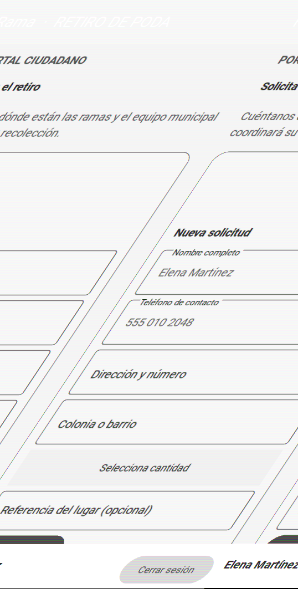
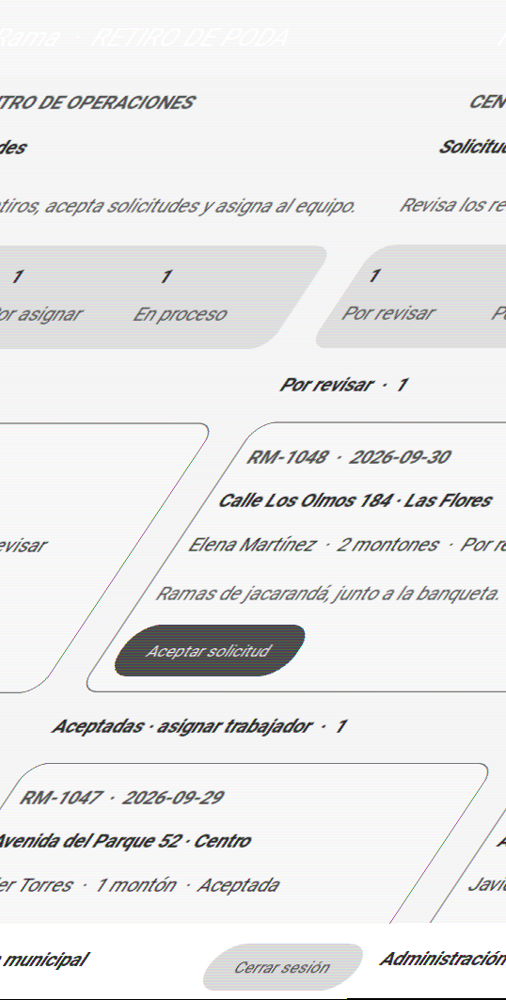
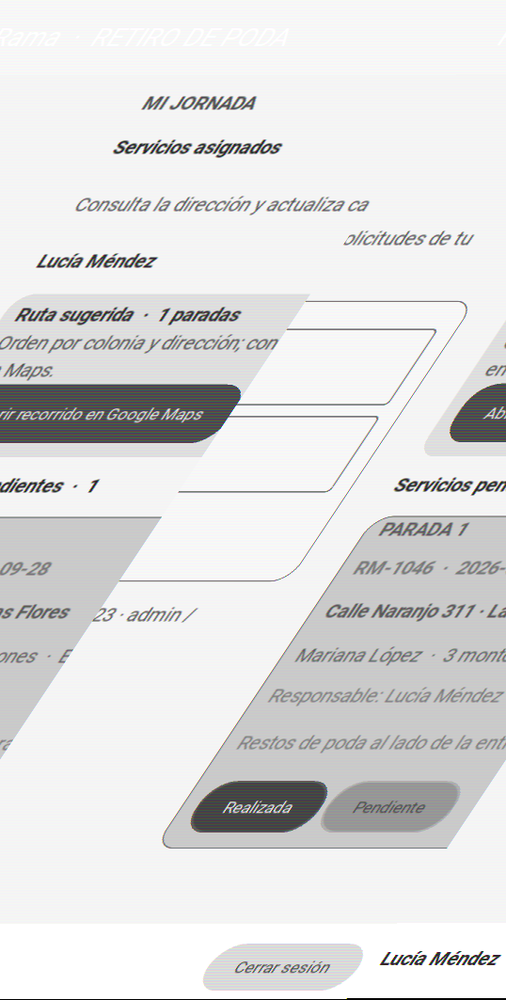

# Rama | Retiro de poda

Rama coordina el retiro municipal de ramas y restos de poda acumulados frente a las viviendas. La demo integra registro e inicio de sesión por rol, solicitudes con fotografía, asignación de trabajadores, seguimiento del servicio, persistencia local, notificaciones en pantalla y configuración remota.

## Ejecutar en Windows

Requisitos: Python 3.11 de 64 bits. Desde la carpeta del proyecto:

```powershell
py -3.11 -m venv .venv
.\.venv\Scripts\Activate.ps1
python -m pip install --upgrade pip
pip install -r requirements.txt
python main.py
```

Para ejecutar las pruebas, desactiva el analizador de argumentos de Kivy antes de iniciar `unittest`:

```powershell
$env:KIVY_NO_ARGS = "1"
python -m unittest discover -v
```

## Componentes y flujo de datos

| Archivo | Responsabilidad |
| --- | --- |
| `main.py` | Arranque, control de sesión, validaciones de interfaz y coordinación de eventos. |
| `rama.kv` | Pantallas de acceso, ciudadano, administración y trabajador. |
| `request_service.py` | Reglas de negocio, autenticación de demostración y persistencia JSON. |
| `remote_config.py` | Descarga con tiempo límite y validación de configuración remota. |
| `remote_config.json` | Valores que se publican en el repositorio para la configuración remota. |
| `test_request_service.py` | Pruebas del flujo de solicitudes, roles y estados. |
| `test_persistence.py` | Pruebas de guardado, recuperación y errores de datos JSON. |
| `test_remote_config.py` | Pruebas de respuesta válida, valores predeterminados y fallas remotas. |

El recorrido de una solicitud es: formulario Kivy → validación de `RequestService` → escritura JSON atómica → actualización de las vistas por rol. Las fotos se copian al directorio privado de datos de Kivy y su ruta queda asociada a la solicitud.

## Dificultades técnicas y soluciones

- **Entorno de ejecución:** en la comprobación de esta entrega, el Python del sistema no tenía Kivy disponible. Se utilizó el entorno virtual del proyecto y se instalaron las dependencias de `requirements.txt`; para reproducirlo en Windows, sigue los pasos de instalación de este README.
- **Conservar datos válidos ante errores de guardado:** escribir directamente sobre el JSON podía dejarlo incompleto si una escritura fallaba. `RequestService._save` escribe primero un archivo temporal en el mismo directorio y luego reemplaza el archivo de datos; además, las pruebas comprueban que un error no sobrescriba datos dañados ni conserve cambios no guardados en memoria.
- **Seguir usando la app sin conexión:** la configuración remota puede no estar disponible. `remote_config.py` valida la respuesta y aplica un tiempo límite; `main.py` consulta en un hilo de fondo y conserva los valores predeterminados locales si la consulta falla, para no bloquear el uso de las solicitudes.

## Persistencia y modo sin conexión

`RequestService` guarda solicitudes, cuentas registradas y trabajadores en `rama_data.json`, dentro de `App.user_data_dir` (directorio privado de la aplicación). La primera ejecución inicializa datos de demostración; las siguientes cargan el archivo existente. Cada cambio se escribe en un archivo temporal y se reemplaza el anterior al terminar, para reducir el riesgo de dejar un JSON incompleto. Si el archivo está dañado o no se puede escribir, el inicio o la operación falla con un error explícito; no descarta ni reemplaza silenciosamente los datos y revierte el cambio no guardado.

Las operaciones de la demo —registro, acceso y seguimiento de solicitudes— no necesitan Internet. Se elige JSON frente a una base de datos porque el volumen es pequeño y la entrega es una demo local de un solo dispositivo: es simple de inspeccionar, respaldar y explicar. JSON no ofrece consultas relacionales, control de concurrencia, transacciones multiusuario ni sincronización entre dispositivos; para el servicio municipal real convendría una API con una base de datos central.

La demo es solo académica. Los datos se guardan en el dispositivo y las contraseñas de demostración no deben considerarse protegidas ni usarse con datos reales. Reinstalar o borrar los datos de la app puede eliminar el archivo local.

## Notificaciones

La interfaz muestra un aviso local temporal sobre la pantalla cuando se envía o edita una solicitud y cuando administración o un trabajador cambia su estado. Se dispara después de validar y guardar el cambio. No es una notificación push ni aparece si la app está cerrada; para eso se necesitarían un backend, registro de dispositivos y un proveedor de notificaciones push. El aviso en pantalla funciona sin conexión.

## Configuración remota y valor predeterminado

Al iniciar, un hilo en segundo plano consulta `remote_config.json` en la rama `main` del repositorio. La configuración actualiza el texto de bienvenida y el municipio utilizado para construir el recorrido de Google Maps. `remote_config.py` aplica un tiempo límite de cuatro segundos y valida los campos antes de usarlos; si falta Internet, el servidor falla o el JSON no es válido, conserva los valores de `DEFAULT_REMOTE_CONFIG` y muestra que está usando la configuración local. No bloquea el acceso ni la gestión de solicitudes.

Para probar otra URL sin cambiar el código (PowerShell):

```powershell
$env:RAMA_REMOTE_CONFIG_URL = "https://tu-servidor/config.json"
python main.py
```

La respuesta debe ser un objeto JSON; `municipality` y `announcement` deben ser textos no vacíos. Los campos omitidos conservan su valor predeterminado. Para que la URL predeterminada lea los cambios publicados, hay que subir `remote_config.json` a la rama `main`; los cambios que solo están en el equipo todavía no son accesibles desde Internet.

## Flujo sugerido para la demostración

1. Inicia sesión con `elena`, envía una solicitud con una foto y muestra el aviso de confirmación.
2. Cierra y vuelve a abrir la app; inicia sesión otra vez y comprueba que la solicitud continúa ahí.
3. Entra como `admin`, acepta la solicitud y asígnala a un trabajador; muestra las notificaciones y el cambio de etapa.
4. Entra como ese trabajador, inicia el retiro y márcalo completado o pendiente con motivo.
5. Inicia la app sin conexión o configura una URL remota inválida. Comprueba que aparece el estado de configuración local y que el valor predeterminado permite seguir usando las solicitudes.
6. Para un caso de error controlado, intenta enviar una solicitud sin foto o deja vacío el motivo de un pendiente; explica por qué la validación la rechaza.

Las cuentas incluidas son de demostración:

| Perfil | Usuario | Contraseña |
| --- | --- | --- |
| Ciudadana | `elena` | `elena123` |
| Ciudadano | `javier` | `javier123` |
| Ciudadana | `mariana` | `mariana123` |
| Ciudadano | `carlos` | `carlos123` |
| Administración | `admin` | `admin123` |
| Trabajadora | `lucia` | `lucia123` |
| Trabajador | `diego` | `diego123` |
| Trabajador | `mateo` | `mateo123` |

El sistema trae solicitudes de ejemplo para recorrer las etapas. Los cambios se conservan entre ejecuciones en el mismo dispositivo; para reiniciar una demo, cierra la app y elimina únicamente `rama_data.json` de su directorio privado de datos.

## Guía breve para la defensa

- **Login:** `RamaMobileApp.sign_in` en `main.py` toma los campos de la pantalla y delega la validación a `RequestService.authenticate`.
- **Guardado JSON:** `RequestService._save` y `RequestService._load` en `request_service.py` guardan y recuperan solicitudes y cuentas. Las operaciones de creación, edición, asignación y cambio de estado llaman a `_save`.
- **Notificación:** `RamaMobileApp._notify` muestra el aviso temporal; `submit_request` y `_change_status` lo disparan después de guardar correctamente.
- **Valor remoto:** `fetch_remote_config` en `remote_config.py` consulta la URL; `_apply_remote_config` actualiza la pantalla y `DEFAULT_REMOTE_CONFIG` cubre fallas o falta de conexión.
- **Decisiones y límites:** JSON es adecuado para una demo local pequeña; una app multiusuario necesita backend y base de datos central. La configuración remota solo cambia parámetros no sensibles. La app usa solicitudes locales y no sincroniza datos entre teléfonos.
- **Cambio en vivo:** modifica temporalmente `DEFAULT_REMOTE_CONFIG["municipality"]` en `remote_config.py` y fuerza la URL remota a fallar para demostrar el valor predeterminado; o cambia el mensaje que envían `submit_request` o `_change_status` a `_notify` en `main.py`. Reinicia y verifica el efecto. Para demostrar persistencia, crea una solicitud, reinicia y vuelve a consultarla.

El equipo debe poder explicar también qué validación protege cada transición, por qué el fallback evita bloquear el flujo y cómo cambiarían estas decisiones para producción. La defensa oral, la participación de cada integrante y los datos reales del socio comunitario son evidencias que debe preparar y completar el equipo; no se deben presentar las cuentas o direcciones ficticias de esta demo como datos comunitarios reales. La solución usa reglas y datos de ejemplo, no geocodifica ni optimiza rutas.

## Capturas







Para regenerarlas: `python capturar_pantallas.py`.

## Declaración de uso de IA

La declaración de uso de IA está en [USO_IA.md](USO_IA.md). El equipo debe comprobar que refleje fielmente el trabajo de todas las personas integrantes y completar las partes que requieren información propia, como el modelo si pueden verificarlo y su reflexión personal.
